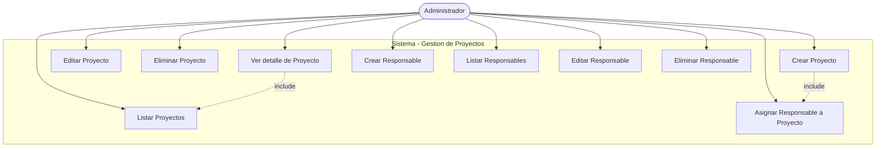
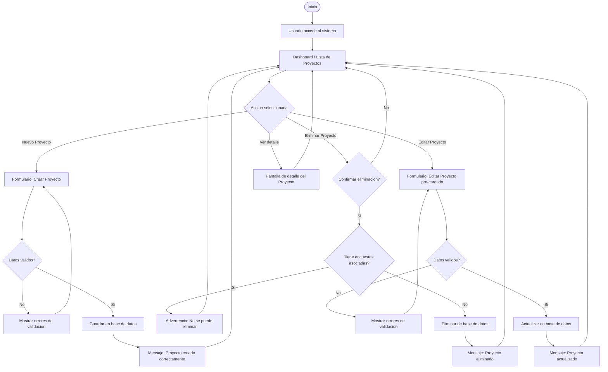
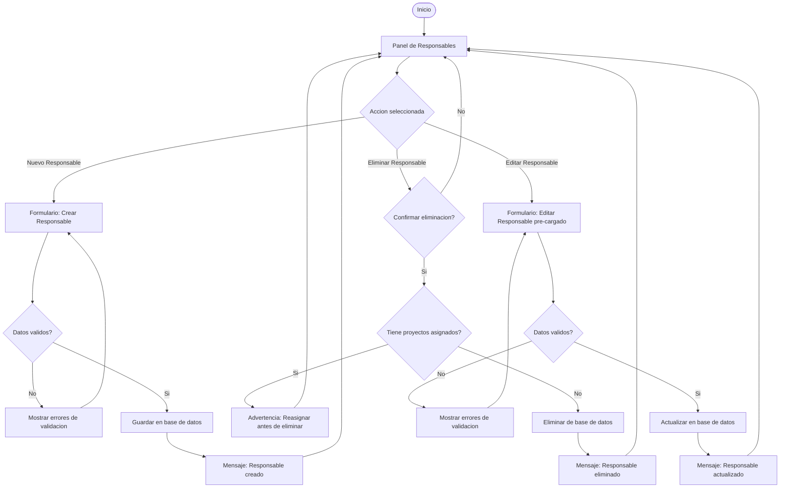

# Modulo 1 - Gestion de Proyectos: Diagramas Previos

> [!IMPORTANT]
> Estos diagramas deben ser confirmados por el usuario antes de iniciar el desarrollo del modulo.

---

## 1. Diagrama de Casos de Uso - Modulo 1

---

## 2. Diagrama de Flujo - ABM Proyectos

---

## 3. Diagrama de Flujo - ABM Responsables

---

## 4. Modelo de Datos - Modulo 1

### Entidad: `Proyecto`
| Campo | Tipo | Descripcion |
|---|---|---|
| `id` | INT PK | Identificador unico |
| `nombre` | VARCHAR(150) | Nombre del proyecto |
| `descripcion` | TEXT | Descripcion general |
| `anio` | INT | Año lectivo (ej: 2026) |
| `estado` | ENUM | `activo`, `finalizado`, `suspendido` |
| `fecha_inicio` | DATE | Fecha de inicio |
| `fecha_fin` | DATE | Fecha estimada de fin |
| `responsable_id` | INT FK | Referencia a Responsable |
| `created_at` | DATETIME | Registro de creacion |
| `updated_at` | DATETIME | Ultima modificacion |

### Entidad: `Responsable`
| Campo | Tipo | Descripcion |
|---|---|---|
| `id` | INT PK | Identificador unico |
| `nombre` | VARCHAR(100) | Nombre completo |
| `email` | VARCHAR(150) | Correo electronico (unico) |
| `rol` | VARCHAR(80) | Rol dentro del proyecto |
| `created_at` | DATETIME | Registro de creacion |

---

## 5. Stack Tecnologico Propuesto

| Capa | Tecnologia | Justificacion |
|---|---|---|
| Frontend | HTML5 + CSS3 (Vanilla) + JavaScript | Simple, sin dependencias de framework pesado |
| Backend | Python + Flask | Ligero, facil de desplegar, ideal para prototipo |
| Base de datos | SQLite (desarrollo) | Sin servidor adicional requerido |
| ORM | SQLAlchemy | Abstraccion de base de datos, migraciones sencillas |
| UI Componentes | Bootstrap 5 | Diseno responsivo profesional sin esfuerzo extra |

---

> [!NOTE]
> El diagrama de casos de uso se actualizara a medida que se integren los modulos 2 al 5.
> Confirmar este documento para proceder con el desarrollo del Modulo 1.
