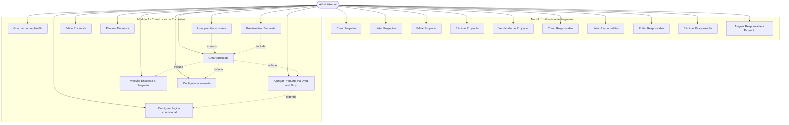
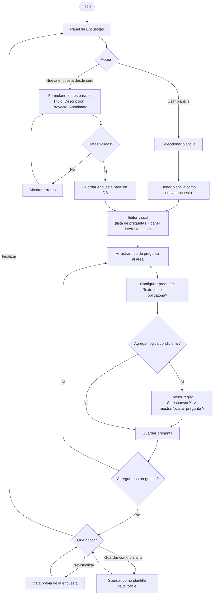
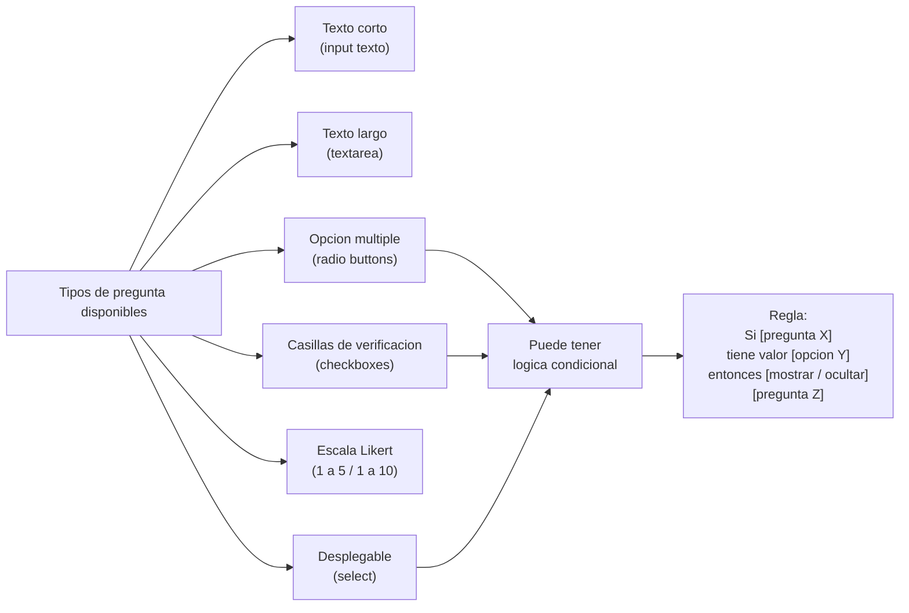

# Modulo 2 - Constructor de Encuestas: Diagramas Previos

> [!IMPORTANT]
> Confirmar este documento antes de iniciar el desarrollo del Modulo 2.

---

## 1. Diagrama de Casos de Uso - Acumulado (Modulos 1 y 2)

---

## 2. Diagrama de Flujo - Crear Encuesta

---

## 3. Diagrama de Flujo - Tipos de Pregunta y Logica Condicional

---

## 4. Modelo de Datos - Modulo 2

### Nuevas entidades

**`Encuesta`**
| Campo | Tipo | Descripcion |
|---|---|---|
| id | INT PK | Identificador |
| titulo | VARCHAR(200) | Titulo de la encuesta |
| descripcion | TEXT | Descripcion opcional |
| proyecto_id | INT FK | Proyecto al que pertenece |
| anonima | BOOLEAN | Si las respuestas son anonimas |
| es_plantilla | BOOLEAN | Si puede usarse como plantilla |
| nombre_plantilla | VARCHAR(100) | Nombre al guardar como plantilla |
| estado | ENUM | borrador / publicada / cerrada |
| created_at | DATETIME | |
| updated_at | DATETIME | |

**`Pregunta`**
| Campo | Tipo | Descripcion |
|---|---|---|
| id | INT PK | Identificador |
| encuesta_id | INT FK | Encuesta a la que pertenece |
| orden | INT | Posicion en el formulario |
| tipo | ENUM | texto_corto / texto_largo / opcion_multiple / checkboxes / likert / desplegable |
| texto | TEXT | Texto de la pregunta |
| obligatoria | BOOLEAN | Si es requerida |
| opciones | TEXT | JSON con las opciones (para tipos multiple/check/desplegable) |
| escala_min | INT | Para Likert: valor minimo |
| escala_max | INT | Para Likert: valor maximo |

**`ReglaCondicional`**
| Campo | Tipo | Descripcion |
|---|---|---|
| id | INT PK | Identificador |
| encuesta_id | INT FK | Encuesta contenedora |
| pregunta_origen_id | INT FK | Pregunta que dispara la regla |
| valor_condicion | VARCHAR(200) | Valor que activa la regla |
| pregunta_destino_id | INT FK | Pregunta afectada |
| accion | ENUM | mostrar / ocultar |

---

## 5. Decisiones de Diseno

| Aspecto | Decision | Justificacion |
|---|---|---|
| Drag and Drop | HTML5 Drag and Drop API nativa | Sin dependencias extra, compatible con Bootstrap |
| Almacenamiento de opciones | JSON en columna TEXT | Flexible, evita tabla extra para opciones |
| Previa de encuesta | Renderizado en la misma pagina en modal | Rapido, sin ruta extra |
| Plantillas | Flag `es_plantilla` en la misma tabla `Encuesta` | Simple, evita duplicar estructura |
| Logica condicional | Tabla separada `ReglaCondicional` | Limpio, extensible, facil de consultar |

---

> [!NOTE]
> El diagrama de casos de uso se seguira actualizando con los Modulos 3 al 5.
> Confirmar este documento para iniciar el desarrollo del Modulo 2.
