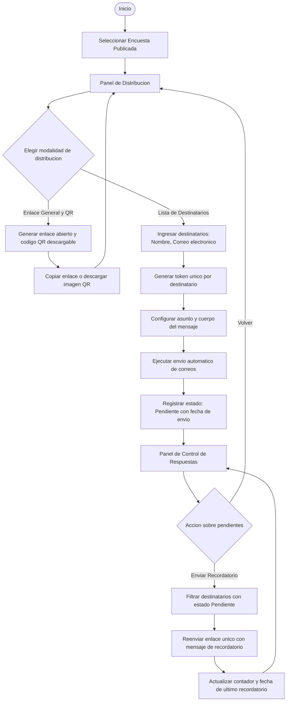
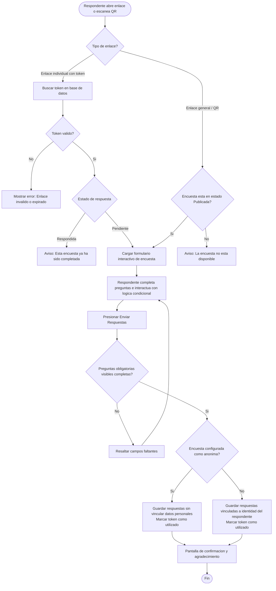

# Modulo 3 - Distribucion y Recoleccion: Diagramas Previos

> [!IMPORTANT]
> Confirmar este documento antes de iniciar el desarrollo del Modulo 3.

---

## 1. Diagrama de Casos de Uso - Acumulado (Modulos 1, 2 y 3)

```mermaid
graph TD
    Admin(["Administrador"])
    Resp(["Respondente / Stakeholder"])

    subgraph M1["Modulo 1 - Gestion de Proyectos"]
        UC1["Crear Proyecto"]
        UC2["Listar Proyectos"]
        UC3["Editar Proyecto"]
        UC4["Eliminar Proyecto"]
        UC5["Ver detalle de Proyecto"]
        UC6["Crear Responsable"]
        UC7["Listar Responsables"]
        UC8["Editar Responsable"]
        UC9["Eliminar Responsable"]
        UC10["Asignar Responsable a Proyecto"]
    end

    subgraph M2["Modulo 2 - Constructor de Encuestas"]
        UC11["Crear Encuesta"]
        UC12["Agregar Pregunta via Drag and Drop"]
        UC13["Configurar logica condicional"]
        UC14["Guardar como plantilla"]
        UC15["Usar plantilla existente"]
        UC16["Editar Encuesta"]
        UC17["Eliminar Encuesta"]
        UC18["Vincular Encuesta a Proyecto"]
        UC19["Previsualizar Encuesta"]
        UC20["Configurar anonimato"]
    end

    subgraph M3["Modulo 3 - Distribucion y Recoleccion"]
        UC21["Generar link publico y enlaces unicos"]
        UC22["Generar codigo QR de acceso"]
        UC23["Cargar lista de destinatarios"]
        UC24["Enviar invitacion por email"]
        UC25["Enviar recordatorios a pendientes"]
        UC26["Monitorear panel de control de respuestas"]
        UC27["Completar encuesta via link o QR"]
        UC28["Validar token unico y evitar duplicidad"]
        UC29["Procesar respuestas respetando anonimato"]
    end

    Admin --> UC1
    Admin --> UC2
    Admin --> UC3
    Admin --> UC4
    Admin --> UC5
    Admin --> UC6
    Admin --> UC7
    Admin --> UC8
    Admin --> UC9
    Admin --> UC10

    Admin --> UC11
    Admin --> UC12
    Admin --> UC13
    Admin --> UC14
    Admin --> UC15
    Admin --> UC16
    Admin --> UC17
    Admin --> UC18
    Admin --> UC19
    Admin --> UC20

    Admin --> UC21
    Admin --> UC22
    Admin --> UC23
    Admin --> UC24
    Admin --> UC25
    Admin --> UC26

    Resp --> UC27
    UC27 -.->|include| UC28
    UC27 -.->|include| UC29
    UC24 -.->|include| UC21
    UC25 -.->|include| UC26
```

---

## 2. Diagrama de Flujo - Distribucion de Encuestas y Recordatorios

---

## 3. Diagrama de Flujo - Recoleccion de Respuestas y Control de Acceso

---

## 4. Modelo de Datos - Modulo 3

### Nuevas entidades

**`Distribucion`**
| Campo | Tipo | Descripcion |
|---|---|---|
| id | INT PK | Identificador unico |
| encuesta_id | INT FK | Encuesta asociada |
| destinatario_nombre | VARCHAR(120) | Nombre del respondente (opcional si es publico) |
| destinatario_email | VARCHAR(150) | Correo electronico (opcional si es publico) |
| token | VARCHAR(64) | Token unico irrepetible para el acceso seguro |
| estado | ENUM | `pendiente`, `respondida`, `cancelada` |
| fecha_envio | DATETIME | Momento del primer envio |
| fecha_ultimo_recordatorio | DATETIME | Momento del envio de recordatorio |
| intentos_recordatorio | INT | Contador de recordatorios enviados |
| fecha_respuesta | DATETIME | Momento en el que se envio la respuesta |

**`Respuesta`**
| Campo | Tipo | Descripcion |
|---|---|---|
| id | INT PK | Identificador de la sesion de respuesta |
| encuesta_id | INT FK | Encuesta respondida |
| distribucion_id | INT FK | Registro de distribucion asociado (NULL si es anonima) |
| respondente_identificador | VARCHAR(150) | Nombre/correo o literal "Anonimo" |
| fecha_completada | DATETIME | Registro temporal de finalizacion |

**`RespuestaDetalle`**
| Campo | Tipo | Descripcion |
|---|---|---|
| id | INT PK | Identificador del detalle |
| respuesta_id | INT FK | Cabecera de la respuesta |
| pregunta_id | INT FK | Pregunta respondida |
| valor_texto | TEXT | Respuesta en texto libre o seleccion unica/escala |
| valor_json | TEXT | Lista serializada para respuestas de tipo casillas de verificacion |

---

## 5. Decisiones de Diseno y Stack para el Modulo 3

| Aspecto | Decision | Justificacion |
|---|---|---|
| Generacion de Codigos QR | Libreria ligera `qrcode` o generador SVG nativo | Rapido, portable y no requiere llamadas a servicios externos |
| Envio de Correos | Modulo centralizado con modo dual (Simulacion en log y SMTP real configurable) | Permite probar el flujo en entorno local de inmediato sin bloquear ejecucion |
| Enlaces Unicos | Tokens alfanumericos seguros generados con `secrets.token_urlsafe` | Alta seguridad contra adivinacion y trazabilidad precisa |
| Anonimato Efectivo | Ruptura de relacion en base de datos: si `anonima=True`, no se graba la clave foranea hacia la identidad del respondente | Garantiza cumplimiento estricto del anonimato |
| Control de Duplicidad | Verificacion del estado del token antes de cargar y antes de guardar | Previene respuestas repetidas en distribuciones individuales |

---

> [!NOTE]
> Confirmar este documento para dar inicio al desarrollo del Modulo 3.
