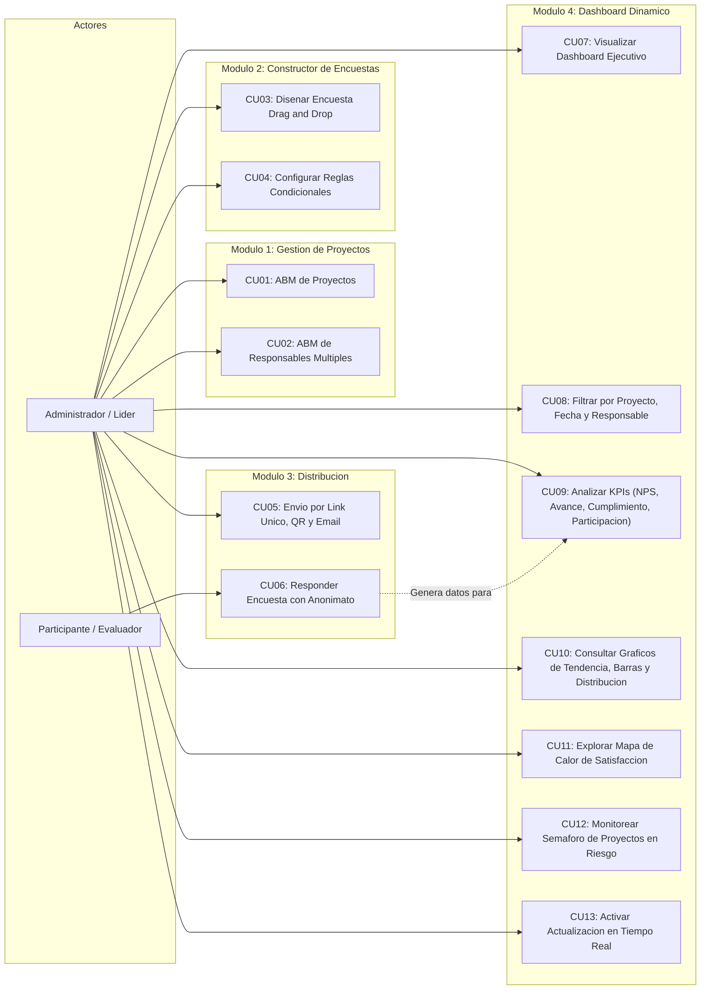
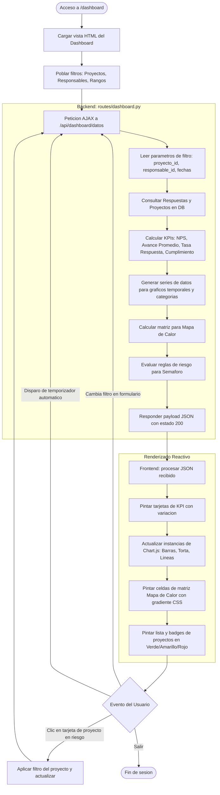

# Modulo 4: Dashboard Dinamico - Diagramas y Especificacion Tecnica

## 1. Descripcion del Modulo

El **Modulo 4 - Dashboard Dinamico** consolida y visualiza en tiempo real los datos recopilados por las encuestas vinculadas a los proyectos de 7mo ano. Proporciona a docentes, directivos y lideres tecnicos una herramienta analitica centralizada para evaluar el desempeno, avance y percepcion de stakeholders mediante indicadores clave y alertas tempranas.

### Componentes Clave:
1. **KPIs Centrales:**
   - **NPS (Net Promoter Score):** Indice de recomendacion calculado a partir de promotores (% puntuaciones 9-10 o 5/5) menos detractores (% puntuaciones 1-6 o 1-2/5).
   - **% de Avance Percibido:** Promedio de progreso estimado por los participantes en encuestas de evaluacion continua.
   - **Tasa de Cumplimiento:** Porcentaje de encuestas respondidas frente a la meta objetivo del proyecto.
   - **Tasa de Participacion:** Porcentaje de respuestas registradas sobre el total de distribuciones enviadas.
2. **Filtros Dinamicos (Multicriterio sin recarga de pagina):**
   - Proyecto especifico o vista global.
   - Rango de fechas (desde / hasta).
   - Responsable asignado.
   - Estado de encuesta y tipo de instrumento.
3. **Visualizaciones:**
   - **Grafico de Barras:** Comparativa de avance y satisfaccion por proyecto.
   - **Grafico de Torta / Dona:** Distribucion de segmentos NPS (Promotores, Pasivos, Detractores).
   - **Grafico de Lineas de Tendencia:** Evolucion temporal de participacion y percepcion a lo largo de las semanas.
   - **Mapa de Calor (Heatmap Matriz):** Desglose de satisfaccion/percepcion por proyecto vs. dimensiones clave (comunicacion, cumplimiento tecnico, organizacion).
   - **Semaforo de Proyectos en Riesgo:** Clasificacion automatica en tres niveles (Verde: Saludable, Amarillo: Alerta, Rojo: Critico) segun umbrales de NPS, avance y respuesta.
4. **Actualizacion en Tiempo Real:**
   - Endpoint `/api/dashboard/datos` con respuesta JSON.
   - Mecanismo de refresco automatico en cliente (polling configurable) e indicador de sincronizacion en vivo.

---

## 2. Diagrama de Casos de Uso (Global y Modulo 4)

---

## 3. Diagrama de Flujo: Operacion del Dashboard Dinamico

---

## 4. Matriz de Clasificacion de Riesgo (Semaforo de Proyectos)

El sistema evaluara automaticamente la salud de cada proyecto activo segun la siguiente logica:

| Nivel de Riesgo | Color | Criterios de Evaluacion | Accion Sugerida |
| :--- | :--- | :--- | :--- |
| **Normal / Saludable** | Verde | NPS >= +30, Avance percibido >= 70%, Tasa respuesta >= 60% | Mantener plan de trabajo habitual. |
| **Atencion / Alerta** | Amarillo | NPS entre 0 y +29, Avance entre 40% y 69%, o Respuesta 35%-59% | Enviar recordatorios y revisar desvio con responsables. |
| **Critico / En Riesgo** | Rojo | NPS < 0, Avance percibido < 40%, o Tasa respuesta < 35% | Reunion urgente con lideres de proyecto y docentes. |

---

## 5. Endpoints y Estructura a Desarrollar

- **Vista Principal:** `routes/dashboard.py` -> `GET /dashboard` (plantilla `templates/dashboard/index.html`).
- **API de Metricas:** `GET /api/dashboard/datos` (soporta query params: `proyecto_id`, `responsable_id`, `desde`, `hasta`, `tipo_encuesta`).
- **Librerias Frontend:** `Chart.js` (cargado via CDN oficial, sin dependencias pesadas adicionales).

