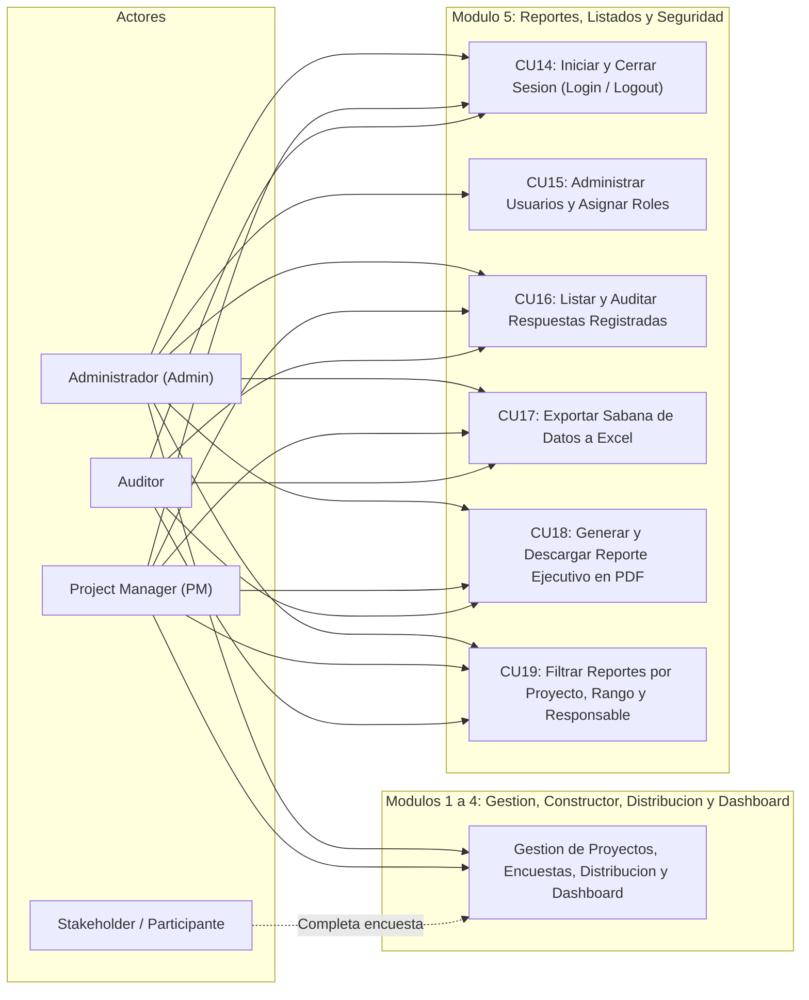
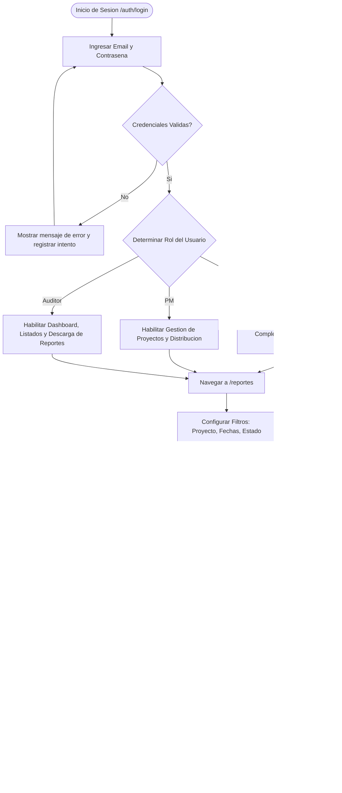

# Modulo 5: Reportes y Listados - Diagramas y Especificacion Tecnica

## 1. Descripcion del Modulo

El **Modulo 5 - Reportes y Listados** complementa el ecosistema computacional dotandolo de capacidades de auditoria, control de acceso basado en roles (RBAC) y exportacion estructurada de datos en formatos universales (PDF y Excel).

### Componentes Clave:
1. **Gestion de Usuarios y Autenticacion:**
   - Modelo de usuarios con credenciales protegidas mediante hashing criptografico.
   - Matriz de control de acceso por roles:
     - **Admin (Administrador General):** Control total del sistema, gestion de usuarios, proyectos, encuestas y eliminaciones.
     - **PM (Project Manager / Docente Lider):** Administracion y seguimiento de sus proyectos asignados, diseno de encuestas y visualizacion analitica.
     - **Auditor:** Perfil de solo lectura enfocado en la fiscalizacion, revision de cumplimiento y descarga de reportes ejecutivos.
2. **Modulo de Reportes y Exportacion:**
   - **Exportacion a Excel (.xlsx / .csv estructurado):**
     - Sabana de respuestas completa con identificadores de pregunta, ponderaciones y marcas temporales.
     - Resumen consolidado de proyectos, avance y estadisticas de participacion.
   - **Exportacion a PDF (Reporte Ejecutivo Formal):**
     - Generacion de informes listos para impresion con cabecera institucional, metricas consolidadas (NPS, cumplimiento, participacion), tabla del semaforo de riesgo y resumen de hallazgos.
3. **Listados y Trazabilidad:**
   - Visualizacion tabular paginada y filtrable para auditoria de respuestas registradas y registros de distribucion.

---

## 2. Diagrama de Casos de Uso (Consolidado Global y Modulo 5)

---

## 3. Diagrama de Flujo: Generacion de Reportes y Control de Acceso

---

## 4. Matriz de Permisos por Rol (RBAC)

| Funcionalidad / Modulo | Admin | Project Manager (PM) | Auditor |
| :--- | :---: | :---: | :---: |
| **Gestion de Usuarios y Roles** | Total | Sin acceso | Sin acceso |
| **ABM de Proyectos y Responsables** | Total | Creacion y Edicion | Solo Lectura |
| **Constructor y Edicion de Encuestas** | Total | Creacion y Edicion | Solo Lectura |
| **Distribucion y Envio de Correos/QR** | Total | Envio y Recordatorios | Solo Lectura |
| **Visualizacion de Dashboard Dinamico** | Total | Total | Total |
| **Exportacion a Excel de Respuestas** | Total | Total | Total |
| **Exportacion de Reporte Formal en PDF** | Total | Total | Total |
| **Eliminacion de Registros Criticos** | Permitido | Restringido | Denegado |

---

## 5. Arquitectura Tecnica del Modulo

- **Rutas Principales:**
  - `routes/auth.py`: Autenticacion (`/login`, `/logout`, `/perfil`).
  - `routes/usuarios.py`: Gestion de usuarios (`/usuarios`).
  - `routes/reportes.py`:
    - `GET /reportes`: Vista central de listados y filtros de auditoria.
    - `GET /reportes/excel`: Exportacion con formato `application/vnd.openxmlformats-officedocument.spreadsheetml.sheet` o `text/csv; charset=utf-8-sig`.
    - `GET /reportes/pdf`: Emision de reporte PDF ejecutivo con encabezados, tabla de KPIs y proyectos.
- **Seguridad:** Decorador `@login_required` y `@requiere_rol('admin', 'pm', 'auditor')` utilizando sesiones de Flask con firmas criptograficas.

